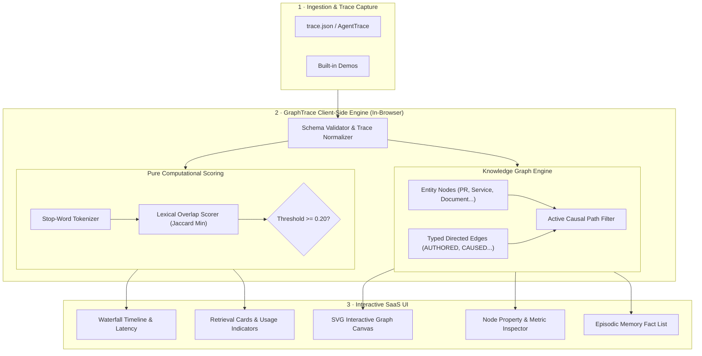

# GraphTrace

> **Graph-based retrieval intelligence and knowledge exploration with multi-hop relationship tracing.**

[](https://www.typescriptlang.org/)
[](https://react.dev/)
[](https://bun.sh/)
[](https://tanstack.com/start)
[](https://tailwindcss.com/)
[](LICENSE)

---

## 1. GraphTrace Introduction

**GraphTrace** is an open-source, client-side developer platform for evaluating, scoring, and visually exploring multi-hop retrieval and knowledge graphs in autonomous AI agents. It bridges the gap between raw vector search, structured knowledge graphs, and final generative answers—enabling developers to pinpoint exactly which pieces of retrieved evidence influenced an agent's reasoning.

GraphTrace operates **100% locally in your browser session**: no proprietary trace data or source code ever leaves your machine, and no secondary LLMs are invoked to compute evaluation metrics.

---

## 2. Problem Statement

When autonomous agents (e.g. built with LangGraph, LlamaIndex, AutoGen, or custom loops) execute retrieval-augmented generation (RAG) tasks:

- **Excess Retrieval Waste**: An agent may retrieve 10 to 50 documents, PRs, or tickets, but the final generated answer only synthesizes information from 2 or 3 items.
- **Context Pollution & Latency**: The unutilized evidence inflates token costs, extends end-to-end latency, and provides a wider attack surface for hallucinations.
- **Black-Box Multi-Hop Traversal**: Vector search alone lacks relational awareness (e.g. _Which PR caused the incident?_ requires navigating `Document -[IMPLICATES]-> PR -[CAUSED]-> Service -[OWNED_BY]-> Team`). Without multi-hop relationship tracing, developers cannot diagnose why an agent picked or missed a causal link.

---

## 3. Project Objectives

1. **Provide Exact Retrieved-vs-Used Signal**: Automatically compute deterministic lexical overlap between retrieved evidence chunks and the generated answer.
2. **Visualize Multi-Hop Causal Paths**: Render interactive knowledge graphs displaying typed edges (`AUTHORED`, `RESOLVES`, `TOUCHES`, `CAUSED`, `IMPLICATES`) and highlighted causal chains.
3. **Inspect Execution Waterfall**: Display granular span latencies across planning, retrieval arms (vector vs graph), and LLM generation phases.
4. **Preserve Privacy & Zero Egress**: Run all scoring algorithms, parsers, and graph renders client-side with zero external cloud dependencies or required API tokens.

---

## 4. Implemented Features

### Retrieval Evaluation & Lexical Overlap

- **Deterministic Token Overlap**: Tokenizes answer text and candidate documents, filters domain stop-words, and calculates vocabulary overlap:
  $$\text{Overlap}(A, C) = \frac{|T(A) \cap T(C)|}{\min(|T(A)|, |T(C)|)}$$
- **Usage Verdict Classification**: Classifies every candidate as:
  - `used` ($\text{Overlap} \ge 0.20$): Displayed with a green indicator tag and overlap score.
  - `no trace` ($\text{Overlap} < 0.20$): Displayed with strikeout styling and unutilized status.
- **Span Waterfall Timeline**: Visualizes execution phases (`retriever`, `llm`, `node`) with relative millisecond timing.

### Interactive Knowledge Graph Explorer

- **Entity Node Support**: Rich representation for `PR`, `Commit`, `Service`, `Person`, `Document`, `Repo`, `Ticket`, `Team`, `Tool`, and `File`.
- **Typed Relationship Edges**: Shows directional dependencies with relationship badges (`AUTHORED`, `RESOLVES`, `TOUCHES`, `CAUSED`, `IMPLICATES`, `DEPENDS_ON`, `OWNED_BY`).
- **Causal Path Isolation**: Dynamic toggle between the full knowledge neighborhood and the active causal trace path.
- **Entity Node Inspector**: Deep-dive into similarity scores, fused router weights, recency decay factors, and direct relations.

### Episodic Memory & Structured Facts

- **Memory Facts Viewer**: Inspect the explicit factual assertions supplied to the agent prompt with distinction between structural relations and agent-remembered facts.

### Developer SaaS UX

- **Theme Support**: Seamless Dark and Light theme toggles with OKLCH dynamic color palettes.
- **Built-in Demos**: Toggle between the Webhook Incident Trace and the Multi-Hop Inventory Pipeline Knowledge Graph.
- **Local File Loader**: Instant drag-and-drop / file selector for custom `.json` trace files.

---

## 5. UI Architecture & Screenshots

```
+-----------------------------------------------------------------------------------------+
| [GT] GraphTrace  [Execution Trace]  [Knowledge Graph]  [Memory Facts]  [Trace/Graph Demo] [Sun] |
+-----------------------------------------------------------------------------------------+
| Query: "Why did the order fulfillment pipeline experience checkout errors?"             |
|                                                                                         |
|  [ Incident Report #104 ] ---IMPLICATES---> [ PR #215 ] ---CAUSED---> [ inventory-service ]|
|          |                                      ^                              |        |
|      RESOLVES                                AUTHORED                       OWNED_BY    |
|          v                                      |                              v        |
|    [ ISSUE-409 ]                          [ Alex Chen ]               [ Logistics Team ]|
+-----------------------------------------------------------------------------------------+
| Grounded Final Answer: PR #215 introduced an inventory lock deduplication change...     |
+-----------------------------------------------------------------------------------------+
```

---

## 6. Technology Stack

| Component                     | Technology                                                                        | Description                                                                 |
| :---------------------------- | :-------------------------------------------------------------------------------- | :-------------------------------------------------------------------------- |
| **Runtime & Package Manager** | [Bun](https://bun.sh/) (v1.4+)                                                    | Fast package installation, execution, and lockfile management               |
| **Framework**                 | [React 19](https://react.dev/) + [TanStack Start](https://tanstack.com/start)     | SSR-capable React application shell                                         |
| **Routing**                   | [TanStack Router](https://tanstack.com/router)                                    | Type-safe, file-based routing architecture                                  |
| **State & Data Fetching**     | [TanStack Query v5](https://tanstack.com/query)                                   | Cache management and client-state handling                                  |
| **Styling & Design System**   | [Tailwind CSS v4](https://tailwindcss.com/)                                       | Modern utility-first styles with OKLCH variables and responsive breakpoints |
| **Icons & Typography**        | [Lucide React](https://lucide.dev/), JetBrains Mono, Space Grotesk                | Developer-focused SaaS visual aesthetic                                     |
| **Testing Suite**             | [Vitest](https://vitest.dev/), Testing Library                                    | Unit tests and routing integration tests                                    |
| **Linting & Code Quality**    | [ESLint 9](https://eslint.org/) (flat config), [Prettier 3](https://prettier.io/) | Formatting and static code quality verification                             |

---

## 7. Architecture Overview



---

## 8. Repository Structure

```
graphtrace/
├── public/                 # Static web assets (favicon, robots.txt)
├── src/
│   ├── components/         # Modular developer SaaS dashboard components
│   │   ├── AnswerPanel.tsx     # Final generated answer & threshold legend
│   │   ├── FactsPanel.tsx      # Grounded episodic memory assertions
│   │   ├── GraphCanvas.tsx     # Interactive multi-hop SVG relationship graph
│   │   ├── NodeInspector.tsx   # Detailed entity metadata & metric inspector
│   │   ├── RetrievalList.tsx   # Expandable retrieval items & overlap tags
│   │   ├── TraceHeader.tsx     # Navigation bar, tabs, theme toggle & loader
│   │   ├── TraceStats.tsx      # Overview statistics cards
│   │   └── TraceTimeline.tsx   # Span waterfall execution timeline
│   ├── lib/                # Pure scoring, types, and utilities
│   │   ├── demo-graph.ts       # Multi-hop payments incident knowledge graph
│   │   ├── demo-trace.ts       # Sample LangGraph webhook execution trace
│   │   ├── error-capture.ts    # Server error recovery and diagnostics
│   │   ├── error-page.ts       # SSR fallback error template
│   │   ├── overlap.ts          # Pure lexical tokenization and overlap scoring
│   │   ├── overlap.test.ts     # Unit tests for scoring algorithm
│   │   ├── trace-types.ts      # Shared entity, graph, and trace definitions
│   │   └── utils.ts            # Class name helper (clsx + tailwind-merge)
│   ├── routes/             # TanStack Router file-based pages
│   │   ├── __root.tsx          # Root shell layout, dark theme class & meta
│   │   ├── index.tsx           # Main GraphTrace application page
│   │   └── README.md           # Route conventions documentation
│   ├── test/               # Integration tests & test setup
│   │   ├── app-routing.test.tsx# Routing regression test
│   │   └── setup.ts            # DOM polyfills for Vitest
│   ├── router.tsx          # Router factory with per-request QueryClient
│   ├── routeTree.gen.ts    # Auto-generated TanStack router manifest
│   ├── server.ts           # SSR server entrypoint
│   ├── start.ts            # TanStack Start middleware configuration
│   └── styles.css          # Tailwind CSS v4 design tokens and theme variables
├── .env.example            # Environment configuration template
├── bun.lock                # Bun lockfile
├── bunfig.toml             # Bun runtime and install configuration
├── eslint.config.js        # Flat ESLint 9 configuration
├── package.json            # Project manifest, dependencies, and scripts
├── tsconfig.json           # Strict TypeScript configuration
├── vite.config.ts          # Vite build configuration
└── vitest.config.ts        # Vitest test runner configuration
```

---

## 9. Installation Instructions

### Prerequisites

- [Bun](https://bun.sh/) (`v1.4.0` or higher) — recommended
- Alternatively: [Node.js](https://nodejs.org/) (`v20.x` or higher) + `npm`

### Setup

1. **Clone the repository:**

   ```bash
   git clone https://github.com/vasantha-kumar-s/graphtrace.git
   cd graphtrace
   ```

2. **Install dependencies:**

   ```bash
   bun install
   ```

3. **Configure environment variables (optional):**
   ```bash
   cp .env.example .env
   ```

---

## 10. Development Commands

| Command              | Description                                           |
| :------------------- | :---------------------------------------------------- |
| `bun run dev`        | Starts the Vite local development server with HMR     |
| `bun run build`      | Compiles an optimized client and SSR production build |
| `bun run preview`    | Previews the compiled production build locally        |
| `bun run test`       | Executes unit and integration tests via Vitest        |
| `bun run test:watch` | Runs Vitest in interactive watch mode                 |
| `bun run lint`       | Runs ESLint 9 across all TypeScript and React files   |
| `bun run format`     | Enforces Prettier formatting across the repository    |

---

## 11. Build and Testing Instructions

To verify production readiness:

```bash
# Run type checking
bun x tsc --noEmit

# Run linting
bun run lint

# Run all test suites
bun run test

# Compile production build
bun run build
```

---

## 12. Environment Configuration

GraphTrace is designed for client-side privacy. Trace ingestion, scoring, and graph traversal run entirely within your local browser runtime.

An optional [.env.example](.env.example) is provided for local hosting:

```bash
# Server Configuration (Optional)
PORT=3000
NODE_ENV=development
```

No external API keys (OpenAI, Anthropic, cloud databases) are required for core trace evaluation.

---

## 13. Known Limitations

- **Lexical Overlap vs. Semantic Paraphrase**: Overlap scoring relies on lexical token matching ($n$-grams and vocabulary sets). If an agent drastically paraphrases technical content without retaining key terms, overlap scores will be lower than actual semantic usage.
- **Trace Size in Browser**: For extremely large graph files ($>10,000$ nodes), client-side SVG rendering may experience lower frame rates compared to WebGL/Canvas implementations.
- **Graph Schema Consistency**: Custom traces must supply valid entity and edge structures (`source`, `target`, `id`, `label`) to render correctly in the Knowledge Graph explorer.

---

## 14. Future Roadmap

- [ ] **WebGL-Accelerated Graph Canvas**: Add PixiJS or WebGL canvas mode for graphs exceeding 20,000 entities.
- [ ] **Run Diffing**: Side-by-side comparison between two agent runs to analyze regressions in retrieval precision.
- [ ] **Python SDK Exporter**: Lightweight `pip install graphtrace` callback for automatic zero-config logging in LangGraph and LlamaIndex.
- [ ] **Interactive Cypher / Path Queries**: In-browser filtering of subgraphs using Cypher-like relationship patterns.

---

## 15. License

This project is licensed under the [MIT License](LICENSE).
